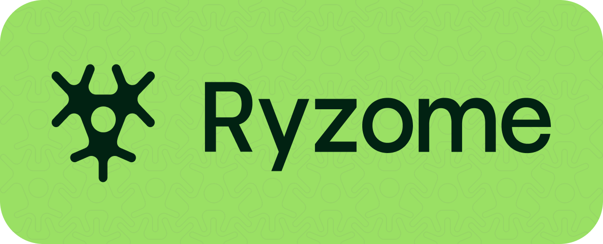

<p align="center">
<picture>
    <source media="(prefers-color-scheme: dark)" srcset="img/rig-rebranded-logo-white.svg">
    <source media="(prefers-color-scheme: light)" srcset="img/rig-rebranded-logo-black.svg">
    
</picture>
<br>
<br>
<a href="https://rig.rs/docs"></a> &nbsp;
<a href="https://docs.rs/rig/latest/rig/"></a> &nbsp;
<a href="https://crates.io/crates/rig"></a>
&nbsp;
<a href="https://crates.io/crates/rig"></a>
&nbsp;
<a href="LICENSE"></a>
</br>
<a href="https://discord.gg/playgrounds"></a>
&nbsp;
<a href=""></a>
&nbsp;
<a href="https://github.com/0xPlaygrounds/rig"></a>
<br>

<br>
</p>
&nbsp;


<div align="center">

[📑 Docs](https://rig.rs/docs)
<span>&nbsp;&nbsp;•&nbsp;&nbsp;</span>
[🌐 Website](https://rig.rs)
<span>&nbsp;&nbsp;•&nbsp;&nbsp;</span>
[🤝 Contribute](https://github.com/0xPlaygrounds/rig/issues/new)
<span>&nbsp;&nbsp;•&nbsp;&nbsp;</span>
[✍🏽 Blogs](https://rig.rs/docs/guides)
<span>&nbsp;&nbsp;•&nbsp;&nbsp;</span>
<a href="https://ryzome.ai"></a>

</div>

✨ If you would like to help spread the word about Rig, please consider starring the repo!

> [!WARNING]
> Here be dragons! As we plan to ship a torrent of features in the following months, future updates **will** contain **breaking changes**. With Rig evolving, we'll annotate changes and highlight migration paths as we encounter them.

## Table of contents

- [Table of contents](#table-of-contents)
- [What is Rig?](#what-is-rig)
- [Features](#features)
- [Runtime choices](#runtime-choices)
- [Who's using Rig?](#who-is-using-rig)
- [Get Started](#get-started)
  - [Simple example](#simple-example)
- [The rig coding agent](#the-rig-coding-agent)
- [Integrations](#supported-integrations)

## What is Rig?
Rig is a Rust library for building scalable, modular, and ergonomic **LLM-powered** applications.

More information about this crate can be found in the [official](https://rig.rs/docs) and [crate](https://docs.rs/rig/latest/rig/) API reference documentation.

## Features
- Agentic workflows that can handle multi-turn streaming and prompting
- A classic agent runtime enabled by default
- Full [GenAI Semantic Convention](https://opentelemetry.io/docs/specs/semconv/gen-ai/) compatibility
- 20+ model providers, all under one singular unified interface
- 10+ vector store integrations, all under one singular unified interface
- Full support for LLM completion and embedding workflows
- Support for transcription, audio generation and image generation model capabilities
- Integrate LLMs in your app with minimal boilerplate
- Browser-WASM (`wasm32-unknown-unknown`) support for the portable core and
  classic runtime — see [target support](crates/rig-agent/README.md#target-support)
  for the full matrix (WASI is not supported; `rig-rmcp`/MCP is native-only)

## Runtime choices

Rig separates portable provider/backend contracts from agent orchestration:

- `rig-core` contains provider-neutral messages, completion models, portable and
  contextual tool contracts, the conversation type, vector-store contracts, and built-in
  provider mappings.
- `rig-agent` contains the classic builder, prompt/streaming traits, typed hooks,
  the live tool registry, extraction, and the serializable `AgentRun` state machine.

The root `rig` facade re-exports both at their familiar paths, `rig-agent` with
its default `agent` feature, so most code depends only on `rig`.

Hosts construct HTTP or SDK models with their chosen authentication, transport
policy and runtime lifetime; the agent runtime executes the resulting
`Model` through one shared adapter. Effect replay uses recorded handlers and
does not require live provider construction.

## Who is using Rig?
Companies, applications, libraries and articles built on Rig are listed in [awesome-rig](https://github.com/0xPlaygrounds/awesome-rig), a community-maintained list. Using Rig? Open a pull request there to add your project.

## Get Started
Use the root `rig` facade when you want feature-gated access to companion crates,
or use `rig-core` directly when you only need the core provider abstractions.

```bash
cargo add rig
# or, without the agent runtime: cargo add rig-core
```

### Simple example
```rust
use rig::prelude::*;
use rig::providers::openai::{self, OpenAI};

#[tokio::main]
async fn main() -> Result<(), anyhow::Error> {
    // The client reads `OPENAI_API_KEY` and builds the models it serves.
    let model = OpenAI::from_env()?.completion(openai::GPT_5_2);
    let comedian_agent = AgentBuilder::new(model)
        .preamble("You are a comedian here to entertain the user using humour and jokes.")
        .build();

    // Prompt the agent and print the response
    let response = comedian_agent.prompt("Entertain me!").await?;

    println!("{}", response.output());

    Ok(())
}
```
Note using `#[tokio::main]` requires you enable tokio's `macros` and `rt-multi-thread` features
or just `full` to enable all features (`cargo add tokio --features macros,rt-multi-thread`).

More examples live in [`examples`](./examples) and each crate's `examples` directory; provider test coverage and cassette commands are described in [`tests/README.md`](./tests/README.md). Detailed walkthroughs are published on our [Dev.to Blog](https://dev.to/0thtachi) and at [rig.rs/docs](https://rig.rs/docs).

## Recording and replay

With the `cassette` feature, `rig::cassette::effect_log` provides logs,
recorders, replay handlers and checkpoints. Keep an `EffectLogRecorder` handle
and attach its clone with `AgentBuilder::record_to`; import
`rig::cassette::agent::AgentReplayExt` to stamp the resulting log or check
replay compatibility.

For transport-free consumers, depend directly on `rig-cassette` with default
features disabled. Its optional `agent` adapter is independent of the native
`http` engine. The agent runtime does not depend on the concrete logging
crate. See the [cassette README](crates/rig-cassette/README.md) for
dependency guarantees and migration paths.

## The rig coding agent

`cargo install rig` also installs `rig`, a terminal coding agent. The agent is
a Bevy app built on the [`rig-harness`](crates/rig-harness) crate, and every
other part of it is a plugin crate in [`plugins/`](plugins). `rig` is its
launcher: it generates a small Cargo project for the agent, builds it, and
runs it. Its coding tools (`read`, `write`, `edit`, `search`, `shell`) are the
[`rig-tools`](crates/rig-tools) crate, usable by any rig agent, and its
kernel (agents, turns and tool calls as Bevy entities, one recorded effect
path, session logs) is the [`rig-ecs`](crates/rig-ecs) crate, for building
your own harness. The agent builds from these crates on crates.io, at the
launcher's version, or from a rig checkout (see the end of this section).

```bash
cargo install rig
export OPENAI_API_KEY=...   # or any other provider key in the model catalog
rig                         # builds the agent (later starts rebuild what changed), then opens it
```

In the agent, `/model` picks a model (providers that need no key, such as a
local Ollama, are listed last), `/effort` its reasoning setting, `/help`
lists the commands, and Esc stops a running turn. The status line shows the
session's tokens (uncached input, output, cache reads and writes), its cost
(the provider's figure, else the catalog's list price; `+` when some calls had
no price) and the context in use against the model's window; `/usage` breaks
them down. A model call that fails on a rate limit, an overloaded provider
or a dropped connection is retried up to four times, waiting as long as the
provider's `Retry-After` asks (or 2, 4, 8, 16 seconds); if it still fails,
your message stays in the conversation and `/retry` sends it again. When the
conversation outgrows the model's context window, older tool outputs are
cleared and the call is sent again. Models whose catalog entry lists a prompt
cache get it, with the agent's id as the cache key where the provider takes
one. When the conversation comes within 16k tokens of the model's window,
older tool outputs are cleared and, if that is not enough, the older messages
are summarized by the model into a structured checkpoint (goal, progress,
decisions, next steps, files read and changed) that requests send in their
place; the newest 20k tokens stay as they are. `/compact` does it now, and
`/compact <focus>` says what the summary should keep. The summarized messages
stay in the transcript, under a line that shows the summary; a resumed
session starts from the messages the summary kept. `/reload` rebuilds the agent
and restarts it on the same session; typed while a turn runs, it waits until no
turn runs (`/reload cancel` drops it), and a turn started during the build
delays the restart until it ends. The agent can ask for a reload itself with
its `reload` tool, which waits the same way and shows a notice. It shows
cargo's latest line, keeps the current build running if the new one does not
compile (its error notice names the build log), and rolls back to it if the new
one crashes during startup. A reload the model asked for reports back: one
message that starts a turn says the new build started, carries the build's
errors, or says the new build was rolled back, so the model carries on without
a second prompt; it may ask for at most 3 reloads per message of yours, and
Esc or `/reload cancel` drops the report. A `-p` run whose model asks for a
reload waits for it and carries on on the new build too.

Every build, the one before each start and `/reload`'s, writes its whole
output (the launcher's and cargo's) to `RIG_HOME/build.log`, and a failure
message names its reason and first compiler error. The agent sees build
failures too: the reason, the first errors and the paths of `build.log`,
`plugins.toml` and the generated project go into its conversation as a
message from the `build` plugin, which starts no turn when the agent is idle
(unless the model asked for that reload) and is saved with the session.
Ask it why the build failed and it can read the log, fix the cause, and
reload.

The session is written as it happens. Each agent, subagents included, has a
log, `sessions/<id>/logs/<agent-id>.jsonl`, of its messages, settings, usage and
compactions, appended to as it runs and rewritten only through rig-memory (a
plugin's redaction, say, keeps each record's place and time); images are stored once in `files/blobs/`, and `files/meta.json`
caches what `/resume` lists. An older session format is resumed and written
on in its own; one from before `rig-session/2` is refused, unchanged. A tool call that may change something starts
only once the reply that asked for it, and a mark that it started, are on
disk. After a crash, a closed terminal or a `/quit` mid-turn, resuming the
session reads the logs back and settles what was left half done: a tool
call that may change something and had started is answered as interrupted
by the restart (or with its result, if it finished before the crash), and a
plugin may answer it first; any other unfinished call, one still waiting for
your approval included, goes through the permission checks again and runs;
and a turn that waited on the model carries on. With
`rig_basics::checkpoint::CheckpointPlugin` enabled (it is listed disabled by
default), every `shell` call (and any other call that may write anywhere)
reports the files it changed, from snapshots of the project before and after
it, kept in the session's scratch directory, never in the repository's
`.git`; `[checkpoints] enabled = false` in `RIG_HOME/settings.toml` turns
that off. `[shell] max_timeout` sets
the longest timeout a `shell` call may ask for (ten minutes by default).
With `[remote.hosts]` in `RIG_HOME/settings.toml`, such as
`bench = ["koh", "exec", "bench", "--sh"]` or `box = ["ssh", "dev@box"]`, a path
written `HOST:PATH` (`bench:~/app/src/lib.rs`) is that host's for every tool:
`read`, `edit`, `write` and `search` act on the file there, and `shell` with
`cwd: "box:~/app"` runs the command there, through the host's command, while
other paths stay on this machine
([rig-basics](plugins/rig-basics/README.md)).
Each `rig` starts a new session. `/quit` ends it. `/new` starts a new session, `/name`
names this one, and `/resume` lists the earlier ones (name or first message,
cost, directory, age) and resumes the one picked, in its own directory;
`rig --resume <id or name>` (or `/resume <id or name>`) resumes a given one,
such as after a crash.

A ChatGPT subscription can pay for the model
calls instead of an API key: `/login chatgpt` opens your browser on the
ChatGPT sign-in page and shows its URL in case the browser does not open; the
page returns to a one-shot listener on `127.0.0.1` port 1455 (1457 when 1455
is taken). Without a graphical session (no `DISPLAY` or `WAYLAND_DISPLAY` on
Linux and the BSDs), over SSH, or when both ports are taken, it shows a code
to enter at `https://auth.openai.com/codex/device` instead, as
`/login chatgpt --device` does. The same applies in print mode, which prints
the URL or code. Once signed in, `/model` lists the
plan's models as `chatgpt/...`, marked "(ChatGPT plan)": `gpt-6.1-sol`,
`gpt-6-astra`, `gpt-6-sol`, `gpt-6-luna`, `gpt-5.6-sol`, `gpt-5.6-terra`,
`gpt-5.6-luna` and `gpt-5.5`, besides the older `gpt-5.4` and `gpt-5.3` rows.
A successful sign-in switches the agent to the plan's latest frontier model,
`chatgpt/gpt-6.1-sol`. Esc or a second `/login` cancels a sign-in that waits. The credential is kept
in `RIG_HOME/auth/chatgpt.json`, readable by you alone, and refreshed before
a request when it has expired, so a long session keeps working (rig
processes running at once take turns refreshing it);
`/logout chatgpt` asks OpenAI to revoke it, then deletes it. It is rig's own sign-in, separate from the Codex
CLI's. A `CHATGPT_ACCESS_TOKEN` in the environment (with `CHATGPT_ACCOUNT_ID`)
is used instead when set. `rig -p /login` signs in without the terminal view.

Typing while the agent works is fine: Enter steers the running turn (the
message goes to the model with its next call, after the tool results it waits
for) and Tab queues a follow-up that is sent when the turn would end. Both
wait under the transcript; Esc stops the turn and puts them back in the input
(a plugin may keep them for the next turn instead), and what the reply had
streamed stays in the transcript, saved as stopped, and is not sent to the
model again. Messages still waiting when the agent exits come back when the
session is resumed.
`@path` to a PNG, JPEG, GIF or WebP file attaches the image when the model
reads images, and Ctrl+V pastes the clipboard's image (through `wl-paste`,
`xclip` or `pngpaste`) as such a path; a dropped image file becomes one too.

With `rig_basics::subagents::SubagentsPlugin` enabled in `plugins.toml` (it is
listed disabled by default; `/plugins` or `rig plugin enable
rig_basics::subagents::SubagentsPlugin` enables it), the model can hand work to subagents
with the `task` tool: each is a new agent in the same process, with its own
conversation and, if the call asks, another model, reasoning setting or a
subset of the tools. `task` returns the subagent's id at once, and `message`
sends one of the model's own subagents a follow-up, which it reads with its
conversation kept. Each `task` or `message` call is a request, and exactly one
report for it (done, failed or stopped) arrives later as a message to the
agent that asked, which starts a turn of an idle agent or follows the running
one (a stopped subagent's report is a note that starts no turn); the reports of one reply's `task` calls reach it together. Nothing waits
for them, so you can keep talking to the main agent, or steer it, meanwhile.
An agent that needs a message before it goes on calls `wait`, which keeps its
turn open until that agent sends it one, and a subagent whose turn ends while
a request it made is open is waiting, not done: it reports the answer it
gives once that request is answered. Esc stops the shown agent's turn and
the turns of every subagent below it, even when the shown agent is idle:
stopping follows who started whom. `/agents` (`rig_basics::sessions::agents::AgentsPlugin`) lists every
agent with its model and state, and shows the one picked: its transcript,
and what you type then goes to it. A
subagent can start subagents of its own, one level deep. Subagents started
with `peers` can also send each other requests with `message` and `wait` for
each other; a request or `wait` that would make agents wait on each other is
refused.
In the effect log, a subagent's model calls name the call that gave it its
work as their parent.

Without the terminal view, `rig -p "fix the failing test"` answers one prompt
and exits: the answer goes to stdout, failures to stderr, and the exit code is
0 when the turn ended with an answer, 2 for a refused slash command. Text piped
in follows the prompt (`git diff | rig -p "review this"`), and piped in
without `-p` it is the prompt: `rig` runs the terminal view only on an
interactive terminal. `-m vendor/model` picks the model (else the session's,
else the first one with a key; in the terminal view too), and `-r <id or name>`
resumes a given session instead of starting a new one; it goes wherever an
option goes, but not among a command's words or after `--`, and
`rig -r <id or name> <command>` runs a plugin's command in that session.
`rig -r <id or name> -p` with no prompt finishes the turn the session left
unfinished, such as one a crash cut short, and prints its answer; with nothing
to finish it exits 2. A plugin may keep such a run going, sending the agent
work over time (`KeepRunning`); each answer is then printed as it comes.

The system prompt is one fixed text, the same on every request of every
session, so the provider's prompt cache keeps the whole conversation behind
it: no date, paths, instruction files or tool rules in it. It tells the model
to read the `AGENTS.md` (or `CLAUDE.md`) files of the working directory and the
directories above it up to the repository root, in its first batch of tool
calls and never above the repository, and each tool says in its own
description when to pick it.

The input takes several lines: Enter sends, Shift+Enter, Ctrl+J or `\` before
Enter starts a new line, Up and Down move between lines and through the
prompts sent before (kept in `RIG_HOME/data/tui/history.jsonl`), and the usual emacs
keys edit (Ctrl+A/E/K/U/W, Alt+B/F/D). A leading `/` completes command names
and `@` completes paths of the project (skipping what `.gitignore` leaves out);
Tab or Enter takes the selected one. A command that is unknown or refused, such
as one with arguments it does not take, comes back in the input with the
reason; Enter then sends it to the model as it is. Ctrl+C clears the input. Answers are drawn as markdown, edits as diffs, and each built-in
tool's call in its own way, always whole: every call's arguments and result,
every diff and every note, nothing cut or folded. Each kind of item has its
own background, mixed from the terminal's: what you wrote one, tool calls and
what plugins add another, the model's replies the terminal's own, and a diff's
removed and added lines red and green, with line numbers and the changed words
on a stronger shade. Code (in replies, read and written files, diffs and shell
commands) is highlighted in the terminal's own palette, so it follows the
terminal's theme. A plugin can draw its own tools' calls with
`app.add_tool_renderer` (`rig_tui::AppToolRenderersExt`). PageUp, PageDown and
Shift+Up/Down scroll the transcript.

Every file lives under `RIG_HOME` (default `~/.rig`): the plugin list
`plugins.toml`, `/login`'s credentials in `auth/`, the generated `project/`, cargo's `target/`, the builds in `bin/`, the last build's output `build.log`,
plugins' data across sessions in `data/` (the prompt history `data/tui/history.jsonl`) and per project in `projects/`, the last chosen model and reasoning `defaults.json` (a new session starts with them), and `sessions/<id>/` with the agent logs in `logs/`, the name `/name` gave it in `name`, `files/` (`meta.json`, the images in `blobs/`, the effect log `effects.jsonl` with `EffectLogPlugin`, plugins' files),
`spill/` (the whole output of a `shell` call that was cut, which the model reads
by the path the cut output names) and the log `agent.log`. `target/` holds cargo's build of the agent and takes a few
gigabytes; set `RIG_HOME` to put everything elsewhere, for example under a
cache directory. Several `rig` processes can share one `RIG_HOME`.

To run the agent from a rig checkout instead of crates.io, install the
launcher from it or point `RIG_SOURCE` at it:

```bash
cd rig && cargo install --path . --root /some/dir
RIG_HOME=/some/dir/home RIG_SOURCE=$PWD /some/dir/bin/rig
```

Plugins are Bevy plugins, listed in `$RIG_HOME/plugins.toml`; `/reload`
rebuilds the agent with them and restarts in the same session. Everything but
the harness (the session and the launcher protocol) is an entry in the same
list: the project context, models, sign-in, sessions, compaction, usage,
activity, each tool, `@path` attachments, `/reload`, `/plugins`, the
commands, `--print` and the terminal view, each from a plugin crate in
[`plugins/`](plugins), most from [`rig-basics`](plugins/rig-basics), so any
of them can be removed or replaced
([`crates/rig-harness`](crates/rig-harness/README.md) lists them):

```toml
[[plugin]]
crate = "rig-basics"              # one of rig's own plugin crates: no source
plugin = "rig_basics::coding_tools::ReadTool"

[[plugin]]
crate = "rig-tui"
plugin = "rig_tui::TuiPlugin"

[[plugin]]
crate = "hello"                   # the package name
path = "plugins/hello"            # relative to plugins.toml; or git = "..." (branch, rev), or version = "..."
plugin = "hello::HelloPlugin"     # implements Plugin + Default
```

`rig plugin new hello` makes that crate in `$RIG_HOME/plugins/hello`, outside
any workspace, and adds its entry; `rig plugin add <type> --path <dir>` (or
`--git`, `--version`) adds an entry for an existing crate and `rig plugin
remove <type>` takes one out (its crate stays), each checked before
plugins.toml is written. A commented-out entry is a disabled plugin: the
template lists every plugin rig ships, the ones not on by default commented
out, and `rig plugin list` shows each entry, `on` or `off`, with its crate
and the comment above it; `rig plugin enable <type>` and `disable <type>`
uncomment and comment out an entry, keeping every other line. In the agent,
`/plugins` is a picker of the same list: tick and untick plugins, press
Enter, and the agent rebuilds and restarts at once (without a terminal it
prints the list). `rig plugin check` checks the list, with `--build` also
building the agent with its plugins in `$RIG_HOME/target` without staging
it and naming the plugins whose systems in one agent-loop stage use the
same data with no order between them; a debug build of the agent warns of
those at start. A plugin crate depends on
`rig-harness`, and on another plugin crate whose types it uses (such as
`rig-tui` for a terminal panel), and registers tools, slash commands, tool
renderers, terminal panels or a window the way the built-in ones do, never by
editing rig's crates. [`crates/rig-harness/PLUGINS.md`](crates/rig-harness/PLUGINS.md)
is the plugin guide, with a copy-ready example of each kind, its names from
`rig_harness::prelude` and the plugin crates, and the `src/lib.rs` that `rig plugin new` writes is a
working, commented slash command. An agent started by the launcher knows
its plugins, commands and tools and how to write and add its own plugins
from its system prompt.

The optional [`rig-inspect`](plugins/rig-inspect) plugin adds the `inspect`
tool, with which the agent reads its own Bevy world, read-only.

Code mode is the optional [`rig-steel`](plugins/rig-steel) plugin: a `run_steel`
tool whose [Steel](https://github.com/mattwparas/steel) (Scheme) program spawns
agents, messages them and calls tools, in a sandbox. Enable it with:

```toml
[[plugin]]
crate = "rig-steel"
plugin = "rig_steel::SteelPlugin"
```

A fan-out that asks three agents at once and keeps the shortest answer:

```scheme
(define agents (map (lambda (i) (spawn-agent (string-append "solver-" (number->string i)))) (range 0 3)))
(define requests (map (lambda (agent) (send agent "How does src/lib.rs load plugins? Three sentences.")) agents))
(define answers (map reply requests))
(foldl (lambda (answer best) (if (< (string-length answer) (string-length best)) answer best))
       (car answers) (cdr answers))
```

The agent, like the rest of the workspace, needs Rust 1.97.1 or newer.

`rig build` regenerates and builds the agent without starting it.
`CARGO_BUILD_JOBS` sets cargo's `-j` for these builds, as for any cargo build.

The agent runs on Linux and macOS; Windows is not supported yet.

## Supported Integrations

The built-in `rig::vector_store::in_memory_store::InMemoryVectorStore` stores
serializable documents without requiring `Eq` or `Default`. Its custom ID
callbacks accept closures that capture and mutate application state. See the
[vector-search example](examples/vector_search/src/main.rs).

The root `rig` facade exposes companion crates behind one feature per integration:

```toml
rig = { version = "0.36.0", features = ["lancedb", "fastembed"] }
```

| Integration | Crate | Feature | Module path |
| --- | --- | --- | --- |
| AWS Bedrock | [`rig-bedrock`](https://github.com/0xPlaygrounds/rig/tree/main/crates/rig-bedrock) | `bedrock` | `rig::bedrock` |
| AWS S3Vectors | [`rig-s3vectors`](https://github.com/0xPlaygrounds/rig/tree/main/crates/rig-s3vectors) | `s3vectors` | `rig::s3vectors` |
| Candle (local Llama/SmolLM2/Qwen3 tools, YOLOv8 pose) | [`rig-candle`](https://github.com/0xPlaygrounds/rig/tree/main/crates/rig-candle) | `candle` | `rig::candle` |
| Cloudflare Vectorize | [`rig-vectorize`](https://github.com/0xPlaygrounds/rig/tree/main/crates/rig-vectorize) | `vectorize` | `rig::vectorize` |
| FastEmbed | [`rig-fastembed`](https://github.com/0xPlaygrounds/rig/tree/main/crates/rig-fastembed) | `fastembed` | `rig::fastembed` |
| Google Gemini gRPC | [`rig-gemini-grpc`](https://github.com/0xPlaygrounds/rig/tree/main/crates/rig-gemini-grpc) | `gemini-grpc` | `rig::gemini_grpc` |
| Google Vertex AI | [`rig-vertexai`](https://github.com/0xPlaygrounds/rig/tree/main/crates/rig-vertexai) | `vertexai` | `rig::vertexai` |
| HelixDB | [`rig-helixdb`](https://github.com/0xPlaygrounds/rig/tree/main/crates/rig-helixdb) | `helixdb` | `rig::helixdb` |
| LanceDB | [`rig-lancedb`](https://github.com/0xPlaygrounds/rig/tree/main/crates/rig-lancedb) | `lancedb` | `rig::lancedb` |
| Conversations over time | [`rig-memory`](https://github.com/0xPlaygrounds/rig/tree/main/crates/rig-memory) | `memory` | `rig::memory` |
| Milvus | [`rig-milvus`](https://github.com/0xPlaygrounds/rig/tree/main/crates/rig-milvus) | `milvus` | `rig::milvus` |
| MongoDB | [`rig-mongodb`](https://github.com/0xPlaygrounds/rig/tree/main/crates/rig-mongodb) | `mongodb` | `rig::mongodb` |
| Neo4j | [`rig-neo4j`](https://github.com/0xPlaygrounds/rig/tree/main/crates/rig-neo4j) | `neo4j` | `rig::neo4j` |
| PostgreSQL | [`rig-postgres`](https://github.com/0xPlaygrounds/rig/tree/main/crates/rig-postgres) | `postgres` | `rig::postgres` |
| Qdrant | [`rig-qdrant`](https://github.com/0xPlaygrounds/rig/tree/main/crates/rig-qdrant) | `qdrant` | `rig::qdrant` |
| ScyllaDB | [`rig-scylladb`](https://github.com/0xPlaygrounds/rig/tree/main/crates/rig-scylladb) | `scylladb` | `rig::scylladb` |
| SQLite | [`rig-sqlite`](https://github.com/0xPlaygrounds/rig/tree/main/crates/rig-sqlite) | `sqlite` | `rig::sqlite` |
| SurrealDB | [`rig-surrealdb`](https://github.com/0xPlaygrounds/rig/tree/main/crates/rig-surrealdb) | `surrealdb` | `rig::surrealdb` |
| TypeSafe Jev (experimental judgments) | [`rig-typesafeai`](crates/rig-typesafeai) | `typesafeai` | `rig::typesafeai` |

`rig::conversation` (from `rig-core`) is the one conversation type. Enabling
`features = ["memory"]` adds `rig::memory`, the `rig-memory` crate: windows,
compaction, and saving, resuming, rewriting and forking conversations and
sessions.

We also have some other associated crates that have additional functionality you may find helpful when using Rig:
- `rig-onchain-kit` - the [Rig Onchain Kit.](https://github.com/0xPlaygrounds/rig-onchain-kit) Intended to make interactions between Solana/EVM and Rig much easier to implement.


<p align="center">
<br>
<br>

</p>
