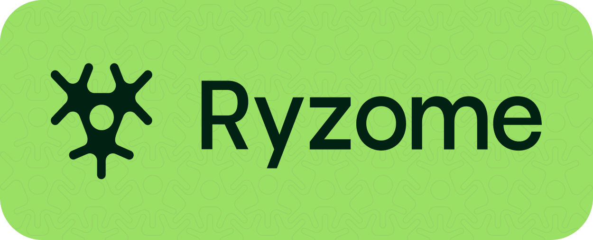

<p align="center">
<picture>
  <source media="(prefers-color-scheme: dark)" srcset="img/rig-rebranded-logo-white.svg">
  
</picture>
</p>

[](https://crates.io/crates/rig)
[](https://docs.rs/rig)
[](https://discord.gg/playgrounds)
<a href="https://ryzome.ai"></a>

Rig is a Rust library for building applications on large language models.
It also ships `rig`, a terminal coding agent built on the library that you
extend with Bevy plugins.

## The coding agent

```bash
cargo install rig
rig
```

This installs the launcher. Until the next release it is 0.46.0, and
[its guide](https://github.com/0xPlaygrounds/rig/blob/v0.46.0/docs/agent.md)
is on its tag. The [agent guide](docs/agent.md#install-and-run) describes
`main` and how to install it from a checkout. The agent needs Rust 1.97.1 or
newer and runs on Linux and macOS.

The first `rig` builds the agent, which takes several minutes, and opens it.
Run `/login` to sign in or save an API key, or export one such as
`OPENAI_API_KEY` before starting. `/model` picks a model and `/help` lists
the commands. `rig -p "fix the failing test"` answers one prompt and exits.

Its tools, commands, sessions, sign-in and terminal view are each a plugin,
so any of them can be turned off, replaced or added to. `/reload` rebuilds
the agent with your changes and keeps the session.

- The [agent guide](docs/agent.md) covers updating, models, sessions, tools,
  settings and scripting.
- The [plugin guide](crates/rig-harness/PLUGINS.md) explains the basics of a
  plugin and points at working examples of each kind.

## The library

```bash
cargo add rig anyhow
cargo add tokio --features macros,rt-multi-thread
```

```rust
use rig::prelude::*;
use rig::providers::openai::{self, OpenAI};

#[tokio::main]
async fn main() -> anyhow::Result<()> {
    // Reads OPENAI_API_KEY.
    let model = OpenAI::from_env()?.completion(openai::GPT_6_1_SOL);
    let agent = AgentBuilder::new(model)
        .preamble("You are a comedian.")
        .build();

    let response = agent.prompt("Entertain me!").await?;
    println!("{}", response.output());
    Ok(())
}
```

Rig puts over 20 model providers and a dozen vector stores behind one
interface. It has agents with tools, streaming and typed hooks. It covers
completion, embedding, transcription, audio and image models and follows the
OpenTelemetry GenAI conventions. `rig-core` and `rig-agent` build for browser
WASM. See [`examples/`](examples), the [guides](https://rig.rs/docs) and the
[API reference](https://docs.rs/rig).

## Crates

The `rig` crate re-exports `rig-core`. Its default features add `rig-agent`,
the derive macros, the reqwest HTTP client with rustls and, on native targets,
the `rig` launcher (feature `cli`, from `rig-cli`); `default-features = false`
leaves them out. Each crate in the list below is a feature named after it
without `rig-`:

```bash
cargo add rig --features memory,fastembed
```

- Agents and state: [`rig-agent`](crates/rig-agent),
  [`rig-memory`](crates/rig-memory) (saved conversations),
  [`rig-cassette`](crates/rig-cassette) (record and replay),
  [`rig-rmcp`](crates/rig-rmcp) (MCP tools).
- Models: [`rig-bedrock`](crates/rig-bedrock),
  [`rig-vertexai`](crates/rig-vertexai),
  [`rig-gemini-grpc`](crates/rig-gemini-grpc),
  [`rig-candle`](crates/rig-candle) (local models),
  [`rig-fastembed`](crates/rig-fastembed) (local embeddings),
  [`rig-typesafeai`](crates/rig-typesafeai) (TypeSafe Jev judgments).

The vector stores, such as LanceDB, Qdrant and PostgreSQL, are companion
crates behind features too; [docs.rs lists every feature](https://docs.rs/crate/rig/latest/features).

Internals: [`rig-core`](crates/rig-core) (messages, models, tools,
providers), [`rig-derive`](crates/rig-derive) (feature `derive`),
[`rig-http`](crates/rig-http) (transport traits),
[`rig-reqwest`](crates/rig-reqwest) (feature `reqwest`) and
[`rig-tungstenite`](crates/rig-tungstenite) (feature `websocket`).

Coding agent: [`rig-cli`](crates/rig-cli) (feature `cli`, the library of the `rig` binary)
and, not facade features, [`rig-harness`](crates/rig-harness),
[`rig-harness-protocol`](crates/rig-harness-protocol),
[`rig-ecs`](crates/rig-ecs), [`rig-tools`](crates/rig-tools),
[`rig-markdown`](crates/rig-markdown), and the plugins
[`rig-basics`](plugins/rig-basics), [`rig-tui`](plugins/rig-tui),
[`rig-fold`](plugins/rig-fold), [`rig-steel`](plugins/rig-steel),
[`rig-mcp-client`](plugins/rig-mcp-client), [`rig-acp`](plugins/rig-acp),
[`rig-inspect`](plugins/rig-inspect), [`rig-traffic`](plugins/rig-traffic)
and [`rig-claude-cloak`](plugins/rig-claude-cloak).

## Community

Ask questions on [Discord](https://discord.gg/playgrounds).
[CONTRIBUTING.md](CONTRIBUTING.md) says how to contribute, and
[awesome-rig](https://github.com/0xPlaygrounds/awesome-rig) lists projects
built on Rig.

Rig is pre-1.0, so releases break APIs. The [changelog](CHANGELOG.md) and
[migration notes](MIGRATING.md) say what changed. Rig is MIT licensed.

<p align="center">

</p>
